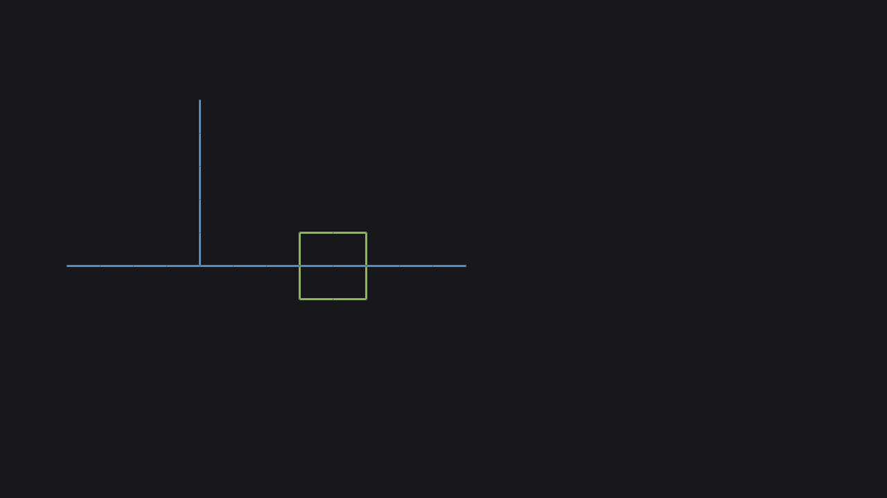

# Dusk

A dark canvas for long sessions: blue wires and green symbols on a near-black grid. Dusk
restyles the canvas only; menus and panels keep your current theme.



## Use it

Install it from the store (Themes), then pick **Use this theme** on its page, or set it in
your `init.lua`:

```lua
schemify.opt.theme = "dusk"
```

## This folder

This is the example store listing of the Schemify plugin docs (`docs/plugins/publishing.md`,
"Your store listing"): a complete theme package. `schemify plugin check examples/listing`
passes on it, and `packages/dusk` is the index entry `schemify plugin publish` writes for it.
